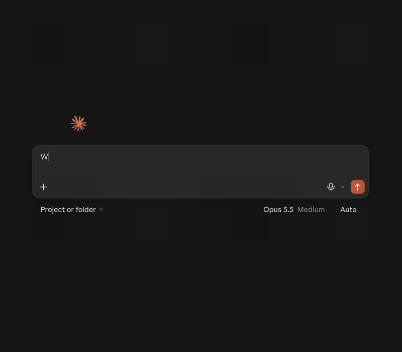

<h1 align="center">Mac Health MCP</h1>

<p align="center">
  <b>Asks your Mac what's wrong and tells you in plain English.</b><br>
  The explanation comes first, then the numbers behind it.
</p>

<p align="center">
  <a href="https://github.com/Swedishwizards/mac-health-mcp/actions/workflows/ci.yml"></a>
  
  
  
  
</p>

---

A [Model Context Protocol](https://modelcontextprotocol.io) server that lets **Claude Desktop, Claude Code** and other MCP clients check your Mac's health: uptime, memory, disk, busy processes, Spotlight, heat, battery and startup items. Ask "Why is my Mac slow?" and Claude gets a ranked list of likely causes, each with a plain explanation, the number behind it and what you can do. Local, read-only, zero dependencies.

Built with Claude.

## Demo

<!--
  DEMO GIF PLACEHOLDER: docs/demo.gif does not exist yet.
  It shows the question "Why is my Mac slow?" in Claude Desktop and the answer.
  How to record it: see docs/DEMO-GIF.md. When the file is added, replace this comment and
  the "coming soon" line below with:
  <p align="center"></p>
-->

*Demo GIF coming soon. Until then, an example conversation (made-up example values):*

```text
You:     Why is my Mac slow?

Claude:  I found 3 likely causes, most likely first:

         1. It has been a long time since the last restart (uptime 23 days).
            Apps and macOS slowly pile up memory and background work over time.
            Restart the Mac when it suits you.
         2. Memory is tight (memory pressure: warning, 4.2 GB swap).
            macOS is moving memory out to the disk, which is much slower.
            The apps using the most memory are ExampleBrowser (3.1 GB) and
            DemoApp (1.8 GB). Closing tabs or apps you don't need will help.
         3. One app is keeping the processor busy (DemoApp at 145 % CPU in both
            measurements). Quit it if you don't need it right now.

         Free disk space, Spotlight, heat, battery health and startup items
         look fine.
```

## Install

### Option A: Claude Desktop, one click (recommended)

1. Download **`mac-health-x.y.z.mcpb`** from the [latest release on GitHub](https://github.com/Swedishwizards/mac-health-mcp/releases/latest).
2. Double-click the file (or drag it into Claude Desktop, or use *Settings → Extensions → Install Extension…*).
3. Click **Install**, then ask Claude: *"Why is my Mac slow?"*

Claude Desktop runs the extension with its own built-in Node.js, so nothing else needs to be installed.

### Option B: manual configuration

Download or clone the repository to a permanent folder. No `npm install` is needed (there are no dependencies). Replace `/path/to/mac-health-mcp` below with the real folder.

```bash
git clone https://github.com/Swedishwizards/mac-health-mcp.git
```

**Claude Desktop:** open *Settings → Developer → Edit Config* (the file `~/Library/Application Support/Claude/claude_desktop_config.json`) and add:

```json
{
  "mcpServers": {
    "mac-health": {
      "command": "node",
      "args": ["/path/to/mac-health-mcp/server/index.js"]
    }
  }
}
```

Restart Claude Desktop afterwards. If Claude Desktop cannot find `node`, use the full path from `which node` (for example `/opt/homebrew/bin/node` or `/usr/local/bin/node`) as `command`.

**Claude Code:**

```bash
claude mcp add mac-health -- node /path/to/mac-health-mcp/server/index.js
```

Any other MCP client: run `node /path/to/mac-health-mcp/server/index.js` as a stdio server.

## Tools

All tools are read-only and local. Every answer starts with a short plain-language summary, followed by the numbers as structured data. The built-in summaries and grades are in Swedish (**Bra** = good, **Okej** = OK, **Behöver åtgärd** = needs attention, **Okänd** = unknown); Claude answers you in your own language.

| Tool | What it does |
|---|---|
| `diagnose_slowness` | Why is my Mac slow? Likely causes ranked, each with the number behind it and what you can do (details below). |
| `get_mac_overview` | Health check of the whole Mac, each part graded (details below). |
| `top_processes` | Which apps and processes use the most CPU and memory right now, grouped per app, with cryptic macOS names explained (optional `limit`, 1-25). |
| `memory_report` | Memory pressure, swap, compressed memory and file cache in plain language, with a grade. |
| `disk_report` | Free space on the startup disk with a grade, plus the largest folders in your home folder. Can take up to about 20 seconds. |
| `battery_report` | Battery health, cycles, charge state, temperature and tips, with a grade. Desktop Macs get a "no battery" answer. |
| `thermal_status` | Whether macOS is slowing the processor down because of heat, with advice. |
| `startup_items` | What starts automatically (launch agents and daemons), marked as Apple or third party. Only lists, never changes. |

### `diagnose_slowness`: the eight checks

Answers "why is my Mac slow?" with a ranked list of likely causes, each with a plain explanation, the number behind it and what you can do.

| Check | Triggers when |
|---|---|
| Uptime | More than 14 days since the last restart |
| Memory and swap | High memory pressure or more than 2 GB swap (names the apps using the most memory) |
| Free disk | Under 10 % free on the startup disk (names the largest home folders) |
| Single process | One process over 80 % CPU in both measurements (`top` over about 1 s and `ps` averaged over about 1 min) |
| Spotlight | `mds_stores` and `mdworker` together over 50 % CPU |
| Heat | `kernel_task` over 50 % CPU and at the same time a heat warning from macOS (`pmset -g therm` reports a thermal or performance warning, or a CPU speed limit under 100 %) |
| Battery health | Under 80 % of new capacity |
| Startup items | 15 or more from third parties (at most three names shown) |

Every command runs once and is shared between the checks. A check is only called "looks good" if it could actually be made; checks that could not run are listed as unknown. Causes are likely, not certain, and nothing is ever changed.

### `get_mac_overview`

A health check of the whole Mac, each part graded, with advice when something is off:

| Part | What it shows | Source |
|---|---|---|
| Model | Model identifier, chip, cores, memory | `sysctl` |
| macOS | Version and build | `sw_vers` |
| Uptime | Time since last restart (restart advice after 14 days) | `sysctl kern.boottime`, fallback `uptime` |
| CPU | Load average per core | `sysctl vm.loadavg`, fallback `uptime` |
| Memory | Free %, memory pressure level, swap, breakdown | `memory_pressure -Q`, `vm_stat`, `sysctl` |
| Disk | Free / total on the startup disk | `df -k /` |
| Battery | Charge, state, health (capacity vs new), cycles (skipped on desktops) | `pmset -g batt`, `ioreg` |
| Thermal | Thermal warnings and CPU speed limit | `pmset -g therm` |

If a command is missing, fails or times out, that part is reported as **Okänd** (unknown) instead of the whole tool failing.

## Privacy

- **Local only.** Everything runs on your Mac with built-in macOS tools (`sysctl`, `sw_vers`, `vm_stat`, `memory_pressure`, `df`, `du`, `top`, `ps`, `pmset`, `ioreg`). No network requests.
- **No telemetry.** Nothing is collected, stored or sent anywhere; the only output is the answer to your MCP client.
- **Read-only.** Never deletes, closes or changes anything. No admin password. `startup_items` only lists folder contents and `disk_report` only reads sizes.
- **Identifiers are filtered out.** Only whitelisted values are parsed, and a final filter on every answer removes serial numbers, UUIDs, hardware IDs, MAC addresses, your user name, your computer name and home folder paths (shown as `~`) before anything is sent to Claude.
- **Safe commands.** Commands run without a shell, with absolute paths, a fixed locale and a timeout.

## Requirements

- macOS. The tools rely on built-in macOS commands; on other systems every tool answers that it only works on macOS.
- Node.js 18 or newer. With the `.mcpb` install (option A) Claude Desktop provides Node.js itself; for manual configuration (option B) Node.js 18+ must be installed.
- No `npm install`, no dependencies.

## Development

```bash
npm test         # runs on any OS (macOS and Linux in CI) with made-up command output from test/fixtures
npm run pack     # builds dist/mac-health-<version>.mcpb with the official packer (downloads it the first time)
npm start        # runs the MCP server over stdio
```

Quick manual check without a client:

```bash
printf '%s\n' \
  '{"jsonrpc":"2.0","id":1,"method":"initialize","params":{"protocolVersion":"2025-06-18"}}' \
  '{"jsonrpc":"2.0","id":2,"method":"tools/list","params":{}}' \
  | node server/index.js
```

Project layout:

```
server/index.js        MCP server (JSON-RPC over stdio), tool definitions, privacy filter on every answer
server/lib/collect.js  runs the read-only macOS commands (no shell, timeouts)
server/lib/parse.js    parses command output (whitelisted fields only)
server/lib/overview.js get_mac_overview: sections and grades
server/lib/diagnose.js diagnose_slowness: the eight checks
server/lib/reports.js  the other tools
server/lib/explain.js  plain-language names for macOS processes
server/lib/privacy.js  removes identifiers before anything leaves
test/                  tests with saved, made-up command output (fixtures) and a fake backend
```

CI runs the tests on macOS (main runner) and Ubuntu with Node 18 and 22, plus a stdio smoke test, and builds the `.mcpb` as a downloadable artifact. Nothing is published from CI.

## License

[MIT](LICENSE)
